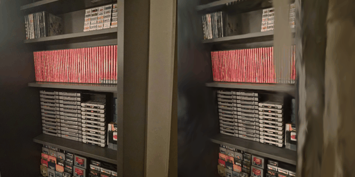

# vulkan_splatting

3D Gaussian splatting (Kerbl et al., SIGGRAPH 2023): rendering and training of splat scenes, written
in ZGAL, the language of the Vulkan wrapper in `external/vulkan_test`. Every program builds
for native Vulkan and for the web (WebGPU, under Node with Dawn or in a page); what the web does
not support is in [docs/web.md](docs/web.md#not-supported-on-the-web).

## Results

Training on a real scene, the 46-camera COLMAP capture `colmap/colmap_exports3` (748×748): 7,000
iterations with `--max-screen-size 20` reach 20.41 dB PSNR and 0.782 SSIM on the six held-out
views. The table of runs, and how to reproduce them, is in [docs/results.md](docs/results.md).

## Build and test

Clone with submodules (`git clone --recursive`, or `git submodule update --init --recursive`), then
`make` builds every program into `build/`, and `make test` runs the tests. The requirements, the
other make targets, the web build and the CI are in
[docs/building-and-testing.md](docs/building-and-testing.md), and [docs/web.md](docs/web.md)
covers the web.

## Training on your own COLMAP data

`tools/convert.py colmap` turns a COLMAP text export into a scene the programs read; `splat_train`
then trains on it and writes an INRIA PLY. The converter's options, the scene's files and the
training options are in [docs/data-format.md](docs/data-format.md) and the
[splat_train section](docs/architecture.md#splat_train) of the architecture doc. A worked example,
from conversion through `tools/scene_args.py --train` to the evaluation, is in
[docs/results.md](docs/results.md#reproducing).

## Viewer controls

`splat_view` shows a scene (a stream, or natively an INRIA PLY) in a window (its options are in the
[splat_view section](docs/architecture.md#splat_view)):

| Input | Does |
| --- | --- |
| W, A, S, D | move forward, left, back, right |
| Q, E | sink, rise |
| drag (left mouse button) | look around |
| scroll | move faster (up) or slower (down) |
| Escape | quit |

## Layout

The fuller version is [docs/architecture.md](docs/architecture.md#layout).

- `programs/`: one directory per program (`splat_render`, `splat_view`, `splat_train`) and per GPU test.
- `lib/`: the ZGAL modules the programs share (the render, view and train graphs, the splat math, SSIM, the stream format).
- `tools/`: the offline Python converter, evaluator and synthetic scene generator, with tests.
- `tests/`: C++ tests and closed-form oracles.
- `colmap/`: the committed COLMAP scene and its images.
- `external/vulkan_test`: the wrapper and ZGAL.

## Docs

- [docs/architecture.md](docs/architecture.md): the layout, the render and train pipelines, and the conventions every kernel follows.
- [docs/building-and-testing.md](docs/building-and-testing.md): building, testing, adding programs and tests, CI.
- [docs/data-format.md](docs/data-format.md): the converter, the scene files and the INRIA PLY format.
- [docs/web.md](docs/web.md): the WebGPU build, its limits and tests.
- [docs/paper-conformance.md](docs/paper-conformance.md): where the code follows the paper and where it departs.
- [docs/results.md](docs/results.md): training runs on real scenes.
- [CLAUDE.md](CLAUDE.md): an index for agents working in the repository.
