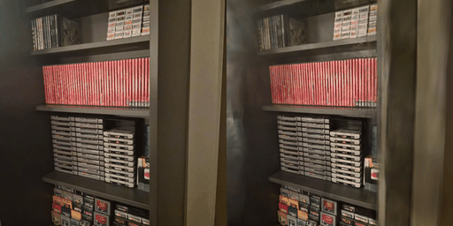
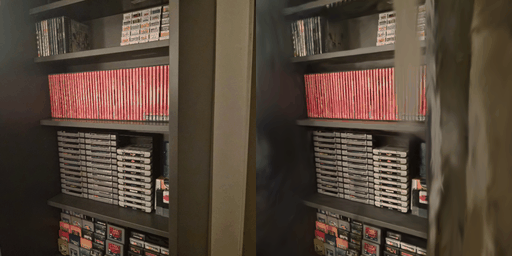
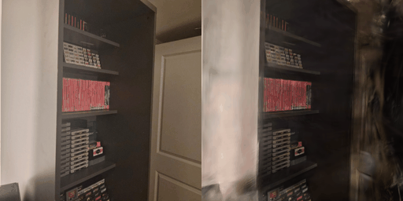
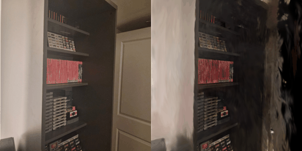
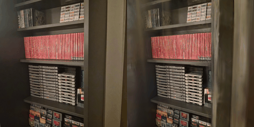
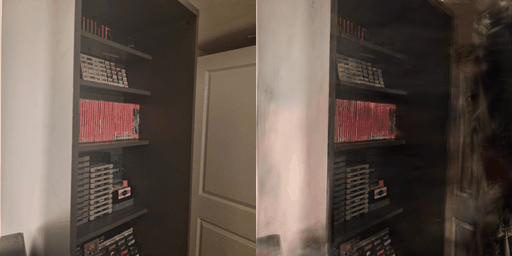

# Results

Training runs on real scenes. Each is scored as the reference's `metrics.py` does, by
`tools/evaluate.py` ([building-and-testing.md](building-and-testing.md#evaluating-a-trained-scene)):
the held-out PSNR and SSIM of the trained PLY rendered by splat_render, with the mean over the test
views. No build outputs are committed. A run writes its PLY wherever `SPLAT_TRAIN_PLY` points
(here under `build/`), and the reproduction commands below rebuild everything.

## cs5330 (COLMAP, 748×748)

The scene is `colmap/colmap_exports3` with the images in `colmap/cs5330_dense_resized`: 46
cameras and 12,900 COLMAP points. Every 8th camera is held out, as the reference's `--eval` does:
views 0, 8, 16, 24, 32 and 40 (6 test, 40 train). The runs were done locally on MoltenVK (Apple
M4), with the reference's learning rates and densification schedule (from 500, every 100, until
15000; opacity reset every 3000). The SH degree rises every 1000 iterations.

| Run | `--max-screen-size` | Iterations | Wall time | Splats | Held-out PSNR | SSIM |
|---|---|---|---|---|---|---|
| validation | 0 | 500 | 15.5 s | 12,900 | 20.16 dB | 0.775 |
| 7k | 0 | 7,000 | 444 s | 400,000 (the cap) | 20.03 dB | 0.790 |
| 7k | 20 | 7,000 | 300 s | 327,505 | 20.41 dB | 0.782 |
| 30k | 0 | 30,000 | 2,533 s | 400,000 (the cap) | 19.97 dB | 0.770 |

- **Wall time**: the whole program run, including loading, the held-out evaluation and the PLY
  export.
- **validation** runs with `--validation` (validation and synchronization validation) and printed
  no validation message. It doesn't densify, because densification starts after iteration 500
  (so its `--max-screen-size` and `--max-splats` changed nothing: it ran with
  `--max-screen-size 0` and the default `--max-splats` 559,240, not the 400,000 of the
  reproduction below).
  An 800-iteration validated run with `--reset-interval 600` covers densification, the opacity
  reset, the size prunes and the tile-entry growth on this scene, and it was clean too.
  - The 7k and 30k runs run without validation.
- **7k, per view** (PSNR / SSIM, views 0, 8, 16, 24, 32, 40):
  - `--max-screen-size 0`: 22.99/0.853, 22.67/0.852, 18.69/0.762, 18.79/0.782, 20.40/0.760,
    16.64/0.733.
  - `--max-screen-size 20`: 23.48/0.849, 20.96/0.814, 19.01/0.755, 22.95/0.838, 20.04/0.732,
    16.04/0.703.
- **30k, per view** (`--max-screen-size 0`): 23.16/0.834, 22.24/0.833, 18.36/0.736,
  19.10/0.755, 20.33/0.735, 16.62/0.726. It scores slightly below the 7k run with the same
  settings: the training loss keeps falling (13.5 times, first epoch to last, against 8.1 at 7k)
  while the held-out views don't improve, so the extra iterations overfit the 40 training views.
  - Its frames peaked at 3,769,648 tile entries, past one backward chunk (3,145,728), so the
    training render ran in two chunk passes there ([architecture.md](architecture.md),
    "Capacity"). Seven iterations were skipped because their frame overflowed the entry
    capacity while it grew (six in the 7k runs).
- **Generalization**: the training views fit far better than the held-out ones. Training views
  1, 9 and 41 scored 32.7, 28.4 and 33.0 dB (SSIM 0.95, 0.93, 0.95) after the
  `--max-screen-size 0` 7k run (the one from before the last iteration stopped densifying, which
  added 50 splats at iteration 7000 that the fixed run doesn't; the held-out numbers above are the fixed runs').
  - Only 40 training views cover a cluttered room. The held-out view 40 sees regions (the door)
    that no training view shows well, so it scores lowest in every run.
- **Loss**: the training loss fell 8.1 times with `--max-screen-size 0` and 3.6 times with 20
  (first epoch to last).

### The last-iteration bug

The first 7k runs were scored before the fix in
[paper-conformance.md](paper-conformance.md) departure 17: iteration 7000 densified before being
scored.
- With `--max-screen-size 20`, that densification pruned 16,084 splats and added 18,811 untrained
  ones right before the evaluation, which scored 18.78 dB and SSIM 0.665.
  - That looked like the 20 px prune hurting this scene, but the fixed run scores 20.41 dB.
- With `--max-screen-size 0`, the 400k cap left only 50 additions at iteration 7000, so it
  scored 20.02 dB and SSIM 0.790, essentially the fixed run's numbers.

### Departures for this scene

- **`--max-splats 400000`**: the reference grows without a bound. These runs were planned when the
  training render's tile entries were capped at 3·2²⁰ = 3,145,728 per frame, because their
  gradients had to fit in one 128 MiB binding. Training now runs its backward pass in chunks of
  at most that many entries, up to 2²⁵ entries a frame (`--max-entries`;
  [architecture.md](architecture.md), "Capacity"), but the 30k run kept the 7k runs' cap so the
  two compare.
  - At the default `--max-splats` (559,240), the run failed around iteration 3000, at 463k
    splats, under the old cap.
  - At 400k, both 7k runs peaked at 3,018,775 entries, 96% of the old cap. Additions past 400k are
    dropped and counted (departure 14): 585,615 with `--max-screen-size 0`, and 62,093 with 20;
    1,439,166 in the 30k run.
- **`--max-screen-size`**: this is a choice, as [paper-conformance.md](paper-conformance.md)
  departure 12 explains. The reference's code effectively runs with 0, because its prune never
  fires, while 20 is what it was written to do. Both 7k runs are shown above.
  - 0 matches the reference's published behaviour, and it was chosen for the 30k run.
  - 20 prunes the large splats, which keeps the splat count and the time down. It scores slightly
    higher on PSNR and slightly lower on SSIM at 7k.
- **The 30k run** (`--max-screen-size 0`, `--max-splats 400000`) first failed just after
  iteration 9000, under the old cap: a frame needed 3,304,022 entries. The splats stop at 400k by
  about iteration 2700, but their footprints keep growing, and with 0 nothing prunes the large
  ones. With chunked backward passes the same run finished, peaking at 3,769,648 entries.

### Side by side

Each image is the photo on the left and the render on the right, for held-out views 8 and 40
after 7k iterations with each `--max-screen-size`, and after 30k with 0.

| 7k, `--max-screen-size 0` | 7k, `--max-screen-size 20` |
|---|---|
|  |  |
|  |  |

| 30k, `--max-screen-size 0` |
|---|
|  |
|  |

### Reproducing

From the repository root, with `.venv` made from `tools/requirements.txt`:

```
.venv/bin/python tools/convert.py colmap colmap/colmap_exports3 build/data/cs5330 \
    --images colmap/cs5330_dense_resized
SPLAT_TRAIN_PLY=build/cs5330/<name>/trained.ply build/splat_train/splat_train \
    $(.venv/bin/python tools/scene_args.py --train build/data/cs5330) \
    --max-splats 400000 --max-screen-size 0 --iterations 7000 --frames 7064
.venv/bin/python tools/evaluate.py build/data/cs5330 build/cs5330/<name>/trained.ply \
    build/splat_render/splat_render build/cs5330/<name>/eval --frames 16 --side-by-side 8 40
```

The 30k run passes `--iterations 30000 --frames 30064`, and the 500-iteration run adds
`--validation`. Pass `tools/evaluate.py` the training run's
`--background` if it wasn't 0, its default; these runs used 0.

The trained PLY is in the INRIA 3DGS format ([data-format.md](data-format.md)), so third-party
viewers that read that format show it. Examples are SuperSplat (in the browser) and the
reference's SIBR viewer.
